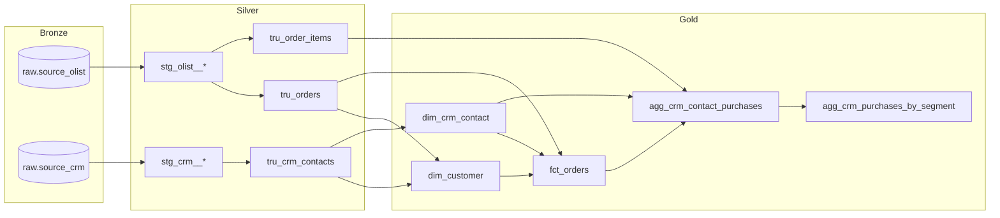

# Fase 4 — Transformação com dbt (Silver e Gold)

Esta fase transforma a Bronze (`raw.source_olist` e `raw.source_crm`) nas camadas **Silver** e **Gold** com **dbt Core + dbt-databricks**, seguindo a mesma organização do projeto Adventure Works: `staging` → `trusted` → `marts`.

**Pergunta de negócio da Gold:** *quais clientes do CRM compram no marketplace, quanto e com que frequência?*

---

## 🗂️ Camadas e catálogos

| Camada | Pasta dbt | Materialização | Catálogo/schema (prod) | Responsabilidade |
|---|---|---|---|---|
| Bronze | — | Delta (PySpark) | `raw.source_olist`, `raw.source_crm` | Dado bruto, tudo string, com metadados de ingestão |
| Silver | `models/staging` | view | `producao.staging` | Tipagem, nomes padronizados, normalização (1:1 com a origem) |
| Silver | `models/trusted` | view | `producao.trusted` | Regras de negócio: pedido válido, valor do pedido, deduplicação do CRM |
| Gold | `models/marts` | table (Delta) | `producao.marts` | Modelo dimensional e agregados para BI/NL2SQL |

No target `dev`, todos os modelos vão para `sandbox.<DBT_DATABRICKS_SCHEMA>`, conforme a macro `generate_schema_name` (a mesma do AW).



---

## 🧱 Modelos

### Staging (10 views)
`stg_olist__customers`, `stg_olist__orders`, `stg_olist__order_items`, `stg_olist__order_payments`, `stg_olist__products`, `stg_olist__product_category_name_translation`, `stg_crm__owners`, `stg_crm__campaigns`, `stg_crm__contacts` e `stg_crm__activities`.

Destaques:
* `stg_olist__products` corrige os nomes com erro de digitação da origem (`product_name_lenght` → `product_name_length`).
* `stg_crm__contacts` normaliza o e-mail (trim + minúsculas, vazio → nulo) e o telefone, que chega em 3 formatos, para **E.164** (`+55DDDNUMERO`).

### Trusted (3 views)
| Modelo | Grão | Regra principal |
|---|---|---|
| `tru_orders` | pedido | `order_value` = produtos + frete; `is_valid_order` = status fora de `invalid_order_statuses` (`canceled`, `unavailable`) |
| `tru_order_items` | item | Categoria em PT e EN |
| `tru_crm_contacts` | contato | **Deduplicação** (mantém maior `updated_at`), enriquecimento com responsável, campanha e atividades |

### Marts (5 tabelas)
| Modelo | Grão | Uso |
|---|---|---|
| `dim_customer` | `customer_unique_id` | Cliente do marketplace + flag `is_in_crm` |
| `dim_crm_contact` | contato | Dimensão do CRM |
| `fct_orders` | pedido | Fato com `customer_sk`, `contact_sk` e `is_after_crm_entry` |
| **`agg_crm_contact_purchases`** | contato | **Resposta da pergunta de negócio**: comprador?, quanto, frequência, recência, categoria favorita, CRM desatualizado |
| `agg_crm_purchases_by_segment` | dimensão × valor | Mesmas métricas consolidadas por origem, estágio, time, segmento e UF |

Decisões de modelagem:
* **Recência** é calculada contra o último pedido do dataset (out/2018), não contra `current_date`, porque o Olist é um snapshot histórico.
* **Frequência** = `avg_days_between_orders` (só para recompradores) e `orders_per_buyer`.
* `days_from_crm_entry_to_first_order` é negativo quando o cliente já comprava antes de entrar no CRM.

---

## ✅ Testes

**114 testes de dados**: `unique`, `not_null`, `relationships` (incluindo CRM → Olist pelo `customer_unique_id`), `accepted_values`, `dbt_utils.accepted_range`, `dbt_utils.unique_combination_of_columns`, `dbt_utils.expression_is_true` e 3 testes singulares em `transform/tests/`:

* `assert_crm_revenue_reconciles_with_orders`: a receita da agregação por contato bate com a fato de pedidos;
* `assert_segment_overall_matches_contacts`: a linha `overall` bate com o grão de contato;
* `assert_email_address_valid`: e-mails normalizados têm formato válido.

No CI, o job `dbt Parse` roda `dbt deps` + `dbt parse` nos targets `dev` e `prod`.

---

## 🚀 Como Executar

```bash
cd transform
cp .env.example .env          # preencha host, http_path e token do SQL Warehouse
set -a && source .env && set +a
dbt deps --profiles-dir .
dbt build --profiles-dir .    # target dev → sandbox.dbt_<seu_nome>
TARGET_ENV=prod dbt build --profiles-dir .   # producao.staging/trusted/marts
```

### Orquestração no Databricks
`databricks/setup/setup_pipeline_olist.py` cria o Job **Pipeline_Olist_Bronze_dbt** com duas tasks: `Ingest_Bronze` (notebook) → `dbt_Build` (dbt task em SQL Warehouse, target `databricks_cluster` = produção).

---

## 📊 Resultado da Gold

Execução completa com o dataset real do Olist e o CRM gerado com `--seed 42`: 18 modelos e 114 testes, todos passando.

| Métrica | Valor |
|---|---:|
| Clientes únicos no Olist | 96.096 |
| Contatos no CRM (após deduplicação) | 20.000 |
| Contatos que compram no marketplace | **14.854 (74,3%)** |
| Recompradores | 1.164 (7,8% dos compradores) |
| Receita dos contatos do CRM | R$ 2,57 mi |
| Ticket médio | R$ 158,68 |
| Intervalo médio entre pedidos (recompradores) | 82,5 dias |
| Receita gerada **após** a entrada no CRM | 77,7% |
| Contatos que compram mas estão como lead/opportunity no CRM | **3.588** |

| Segmento | Contatos | Pedidos/contato | Receita média | Ticket |
|---|---:|---:|---:|---:|
| `never_bought` | 5.146 | 0 | — | — |
| `one_time_buyer` | 13.690 | 1,00 | R$ 161,12 | R$ 161,12 |
| `repeat_buyer` | 1.164 | 2,13 | R$ 309,42 | R$ 145,16 |

> ⚠️ As compras são dados reais do Olist, mas o CRM é fictício: distribuições como taxa de compra por `lead_source` ou por time refletem as regras do gerador (Fase 3), não comportamento real. O valor do projeto está no pipeline e na modelagem, que funcionariam igual com um CRM real.

---

## Próxima Fase
→ Fase 5: Interface analítica (Streamlit + agente NL2SQL) consumindo `producao.marts` *(em breve)*
